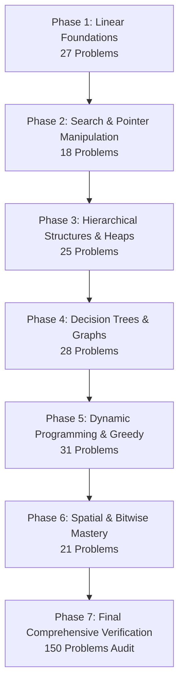

# NeetCode 150 – Phase-Wise Implementation & Mastery Plan

A structured, 6-phase master plan to study, implement, and verify all 150 NeetCode problems.

---

## 1. Study & Implementation Template for Every Problem

Every problem will be delivered using a standardized, in-depth format:

```markdown
### [Problem #] Problem Name (Difficulty)
- **LeetCode Link**: URL
- **Key Pattern / Concept**: (e.g., Two Pointers, Monotonic Decreasing Stack, Topo-Sort)
- **Mental Model & Intuition**: How to derive the optimal approach from scratch in an interview.
- **Tips, Tricks & Pitfalls**:
  - Crucial invariant to maintain
  - Common edge cases (empty input, negatives, duplicates, overflow)
  - Memory/time optimization tricks
- **Fully Commented Solution**:
  - Idiomatic, clean code
  - Line-by-line inline annotations explaining the "why", not just the "what"
- **Complexity Analysis**:
  - Time Complexity: $O(...)$ with mathematical proof/explanation
  - Space Complexity: $O(...)$ auxiliary vs. input memory
- **Verification & Test Suite**:
  - Standard test cases
  - Edge cases (null/empty, single element, extreme constraints)
  - Runnable assertion code
```

---

## 2. Phase-by-Phase Roadmap



---

### Phase 1: Linear Foundations (27 Problems)
> **Goal**: Master in-place transformations, frequency maps, sliding sub-arrays, and LIFO operations.

* **Module 1.1: Arrays & Hashing (9 Problems)**
  * *Patterns*: Hash map lookups, prefix products, frequency buckets, coordinate hashing.
  * *Problems*: Contains Duplicate, Valid Anagram, Two Sum, Group Anagrams, Top K Frequent Elements, Encode and Decode Strings, Product of Array Except Self, Valid Sudoku, Longest Consecutive Sequence.
* **Module 1.2: Two Pointers (5 Problems)**
  * *Patterns*: Inward-converging pointers, fast/slow boundaries, three-pointer reduction.
  * *Problems*: Valid Palindrome, Two Sum II, 3Sum, Container With Most Water, Trapping Rain Water.
* **Module 1.3: Sliding Window (6 Problems)**
  * *Patterns*: Dynamic expansion/contraction, monotonic tracking, frequency budget.
  * *Problems*: Best Time to Buy/Sell Stock, Longest Substring Without Repeating Characters, Longest Repeating Character Replacement, Permutation in String, Minimum Window Substring, Sliding Window Maximum.
* **Module 1.4: Stack (7 Problems)**
  * *Patterns*: Parentheses matching, Monotonic Increasing/Decreasing Stacks, Polish notation evaluation.
  * *Problems*: Valid Parentheses, Min Stack, Evaluate Reverse Polish Notation, Generate Parentheses, Daily Temperatures, Car Fleet, Largest Rectangle in Histogram.
* 🛡️ **Phase 1 Verification Milestone**:
  * Solve 3 unseen mixed-pattern problems within 45 minutes.
  * Pass automated test suites for all 27 problems with $100\%$ edge-case coverage.

---

### Phase 2: Search & Pointer Manipulation (18 Problems)
> **Goal**: Master $O(\log n)$ search spaces and pointer rewiring without memory leaks.

* **Module 2.1: Binary Search (7 Problems)**
  * *Patterns*: Standard binary search, rotated pivot detection, binary search on answers (monotonic predicate functions).
  * *Problems*: Binary Search, Search 2D Matrix, Koko Eating Bananas, Find Min in Rotated Sorted Array, Search in Rotated Sorted Array, Time-Based Key-Value Store, Median of Two Sorted Arrays.
* **Module 2.2: Linked Lists (11 Problems)**
  * *Patterns*: Dummy head sentinel, fast & slow pointers (Floyd's cycle detection), pointer reversal, merge routines.
  * *Problems*: Reverse Linked List, Merge Two Sorted Lists, Reorder List, Remove Nth Node From End, Copy List with Random Pointer, Add Two Numbers, Linked List Cycle, Find the Duplicate Number, LRU Cache, Merge k Sorted Lists, Reverse Nodes in k-Group.
* 🛡️ **Phase 2 Verification Milestone**:
  * Write boundary conditions for binary search without off-by-one errors ($left < right$ vs. $left \le right$).
  * Implement LRU Cache and Reverse in k-Groups from memory with zero pointer bugs.

---

### Phase 3: Hierarchical Structures & Heaps (25 Problems)
> **Goal**: Master DFS/BFS tree traversals, BST properties, prefix tries, and heap-ordered priority queues.

* **Module 3.1: Binary Trees & BST (15 Problems)**
  * *Patterns*: Post-order/pre-order/in-order recursive frames, BFS level-order queues, BST range validation, tree serialization.
  * *Problems*: Invert Binary Tree, Max Depth, Diameter, Balanced Tree, Same Tree, Subtree of Another Tree, Lowest Common Ancestor, Level Order Traversal, Right Side View, Count Good Nodes, Validate BST, Kth Smallest in BST, Construct Tree from Pre/In-order, Max Path Sum, Serialize & Deserialize Binary Tree.
* **Module 3.2: Tries (3 Problems)**
  * *Patterns*: 26-ary tree nodes, prefix lookups, wildcard backtracking over tries.
  * *Problems*: Implement Trie, Design Add & Search Words, Word Search II.
* **Module 3.3: Heap / Priority Queue (7 Problems)**
  * *Patterns*: Min-heap vs max-heap balancing, top-$k$ tracking, event/interval scheduling.
  * *Problems*: Kth Largest in Stream, Last Stone Weight, K Closest Points, Kth Largest in Array, Task Scheduler, Design Twitter, Find Median from Data Stream.
* 🛡️ **Phase 3 Verification Milestone**:
  * Explain recursion stack frame limits and how to convert any recursive tree traversal to iterative.
  * Dual-heap balance verification for running median.

---

### Phase 4: Decision Trees & Graph Algorithms (28 Problems)
> **Goal**: Master combinatorial state-space exploration, cycle detection, and shortest paths.

* **Module 4.1: Backtracking (9 Problems)**
  * *Patterns*: State-space exploration, pick/skip decision branches, backtracking with pruning, constraint propagation.
  * *Problems*: Subsets, Combination Sum, Permutations, Subsets II, Combination Sum II, Word Search, Palindrome Partitioning, Letter Combinations of Phone Number, N-Queens.
* **Module 4.2: Graphs (13 Problems)**
  * *Patterns*: Grid matrix DFS/BFS, connected components, Kahn's algorithm (Topological Sort), cycle detection in directed/undirected graphs.
  * *Problems*: Number of Islands, Max Area of Island, Clone Graph, Walls and Gates, Rotting Oranges, Pacific Atlantic Water Flow, Surrounded Regions, Course Schedule I & II, Graph Valid Tree, Number of Connected Components, Redundant Connection, Word Ladder.
* **Module 4.3: Advanced Graphs (6 Problems)**
  * *Patterns*: Dijkstra's shortest path, Prim's / Kruskal's MST, Bellman-Ford / Floyd-Warshall concepts.
  * *Problems*: Reconstruct Itinerary, Min Cost to Connect All Points, Network Delay Time, Swim in Rising Water, Alien Dictionary, Cheapest Flights Within K Stops.
* 🛡️ **Phase 4 Verification Milestone**:
  * Identify within 30 seconds whether a graph problem requires BFS, DFS, Dijkstra, or Topological Sort.
  * Proof of time complexity for Backtracking ($O(2^n)$ vs $O(n!)$ vs $O(k^n)$).

---

### Phase 5: Dynamic Programming & Greedy (31 Problems)
> **Goal**: Master subproblem decomposition, state transitions, memoization, and optimal substructure.

* **Module 5.1: 1-D Dynamic Programming (12 Problems)**
  * *Patterns*: Fibonacci progression, decision transitions (rob / don't rob), unbounded knapsack, longest increasing subsequence with binary search.
  * *Problems*: Climbing Stairs, Min Cost Climbing Stairs, House Robber I & II, Longest Palindromic Substring, Palindromic Substrings, Decode Ways, Coin Change, Maximum Product Subarray, Word Break, Longest Increasing Subsequence, Partition Equal Subset Sum.
* **Module 5.2: 2-D Dynamic Programming (11 Problems)**
  * *Patterns*: Grid paths, string alignment (LCS, Edit Distance), 0/1 knapsack variants, interval DP.
  * *Problems*: Unique Paths, Longest Common Subsequence, Best Time to Buy/Sell Stock with Cooldown, Coin Change II, Target Sum, Interleaving String, Longest Increasing Path in Matrix, Distinct Subsequences, Edit Distance, Burst Balloons, Regular Expression Matching.
* **Module 5.3: Greedy Algorithms (8 Problems)**
  * *Patterns*: Local optimal choice, Kadane's algorithm, jump reachability tracking, matching parenthesis state ranges.
  * *Problems*: Maximum Subarray, Jump Game I & II, Gas Station, Hand of Straights, Merge Triplets, Partition Labels, Valid Parenthesis String.
* 🛡️ **Phase 5 Verification Milestone**:
  * Derive recurrence relations on paper before writing any code.
  * Space optimization: Reduce 2D DP matrices from $O(m \times n)$ to $O(n)$ space.

---

### Phase 6: Spatial, Intervals & Bitwise Mastery (21 Problems)
> **Goal**: Master interval conflict resolution, 2D matrix transformations, and low-level bit manipulation.

* **Module 6.1: Intervals (6 Problems)**
  * *Patterns*: Sorting by start time, greedy merging, active interval heaps.
  * *Problems*: Insert Interval, Merge Intervals, Non-overlapping Intervals, Meeting Rooms I & II, Minimum Interval to Include Each Query.
* **Module 6.2: Math & Geometry (8 Problems)**
  * *Patterns*: Matrix transposition & reflection, spiral layer bounds, fast exponentiation by squaring, hash map geometry.
  * *Problems*: Rotate Image, Spiral Matrix, Set Matrix Zeroes, Happy Number, Plus One, Pow(x, n), Multiply Strings, Detect Squares.
* **Module 6.3: Bit Manipulation (7 Problems)**
  * *Patterns*: XOR cancellation, Brian Kernighan's bit-counting ($n \& (n-1)$), bitmasking, bitwise addition with carry.
  * *Problems*: Single Number, Number of 1 Bits, Counting Bits, Reverse Bits, Missing Number, Sum of Two Integers, Reverse Integer.
* 🛡️ **Phase 6 Verification Milestone**:
  * Zero-extra-memory matrix rotation and in-place manipulation.
  * Solve bitwise addition and bit counts without any built-in functions.

---

## 3. Double-Check & Verification Protocol

At the end of each module and upon full completion:

1. **Automated Unit Testing**:
   * Every problem includes an automated assertion suite with edge cases (empty inputs, singletons, max bounds, negative numbers).
2. **Complexity Sanity Check**:
   * Strict verification that runtime complies with LeetCode limits (avoiding $O(n^2)$ where $O(n \log n)$ or $O(n)$ is expected).
3. **Pattern Identification Quiz / Blind Recall**:
   * Given a random problem statement without tags, identify the correct data structure, approach, and edge cases in under 3 minutes.
4. **Mock Interview Simulation**:
   * 45-minute timed challenges pairing 1 Medium and 1 Hard problem from different categories.
